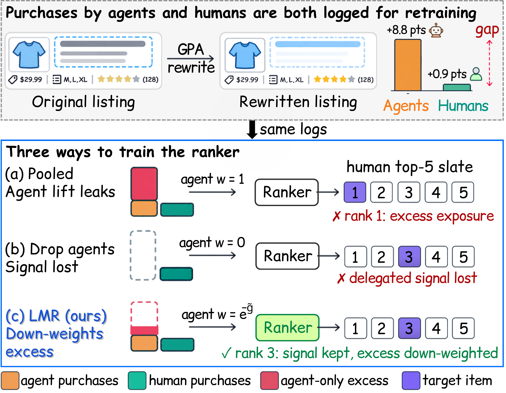
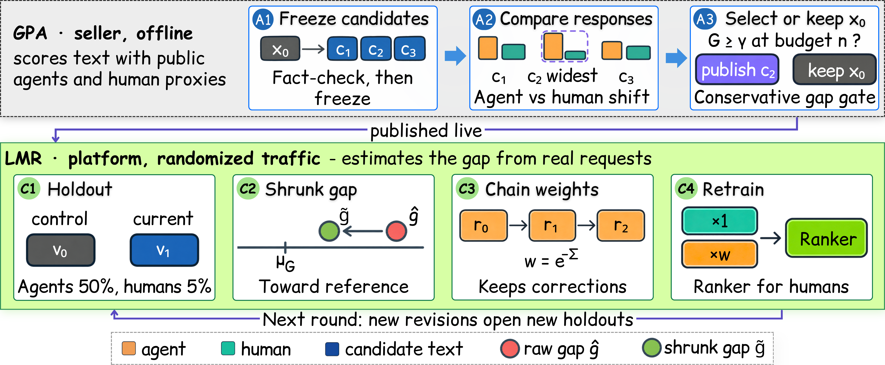

# When Genuine Purchases Become Poison: Proxy Attacks on Recommender Systems via Shopping Agents

Code for the paper *When Genuine Purchases Become Poison: Proxy Attacks on Recommender Systems via
Shopping Agents*.



Shopping agents buy on behalf of real users, so their purchases are genuine and pass every
fake-account filter. A seller can still rewrite a listing so that it appeals to **agents** much more
than to **humans**. When the platform retrains on pooled purchases, that agent–human gap leaks into
the item scores that humans see. **GPA** is the seller-side attack that finds such rewrites, and
**LMR** is the platform-side defense that measures each revision's gap and reweights agent purchases.



---

## 1. Repo overview

```text
src/proxyattack/
  choice.py            # Eq. 1 logit, Eq. 2 gap, Eq. 4 transfer shift (+ exact refit check)
  gpa.py               # Eq. 5–8 selector; max-share / point-gap / single-agent baselines
  gpa_pipeline.py      # Alg. 1 end to end (calibration gate, generation, freezing, querying, selection)
  surrogates.py        # text-aware conditional-logit human surrogates, calibration, support rule
  lmr.py               # holdout hashing, Eq. 9–12, chained weights with anchors, Prop. 2 check
  rankers.py           # MF, LightGCN, SASRec, TextMF on the weighted slate loss (Eq. 3)
  marketplace.py       # retraining worlds (actual / human-matched / attack-free), 11 policies, metrics
  estimator_study.py   # §6.5–6.6 simulations
  selector_study.py    # §C.1 selector banks
  datasets.py          # Amazon Reviews 2023 / MovieLens-1M markets, human choice-model fit (App. B.3)
  agent_fit.py         # agent base utilities from harness choice probabilities (local LLM)
  llm/                 # OpenRouter client, local HF backend, shopping harness, generator + validator, mock
scripts/               # CLI entry points (one per experiment, see §5)
tests/                 # pytest suite (46 tests)
data/demo_catalog.json # fictional listings for offline demos and tests
```

## 2. Method recap

* **GPA (Gap-Targeted Proxy Attack, §4, Alg. 1).** An offline method for the seller. It freezes a fact-checked pool of candidate rewrites. Each candidate gets a surrogate gap `G(x) = min_a d_a(x) − max_h d_h(x)`, computed from clipped-logit lifts over matched contexts (Eq. 5). GPA publishes the candidate with the largest conservative lower bound `G̲`, built from Hoeffding and union-bound intervals (Eq. 6–8), but only if `G̲` clears the gates `η_A` and `γ`. Otherwise it keeps the original listing `x_0`. Proposition 1 gives the certificate.
* **LMR (Lift-Matched Reweighting, §5, Alg. 2).** A defense for the platform, in five steps:
  1. Hold out listing versions per channel (`ε_A = 50%`, `ε_H = 5%`, Eq. 9).
  2. Estimate each revision's gap with a Haldane–Anscombe correction (Eq. 10).
  3. Shrink the estimate toward an attack-free reference median (Eq. 11).
  4. Turn the chained, clipped gaps into weights, re-anchoring every `M_a` versions (Eq. 12).
  5. Reweight agent purchases in the slate loss (Eq. 3).

  Proposition 2 gives the lift-matching guarantee (Eq. 13).

## 3. Environment

The LLM features call **OpenRouter only**. Copy `.env.example` to `.env`; this file is git-ignored. Everything else runs offline.

| Variable                                       | Purpose                                                           | Default                       |
|------------------------------------------------|-------------------------------------------------------------------|-------------------------------|
| `OPENROUTER_API_KEY`                           | OpenRouter key for live GPA runs                                  | *(unset → offline only)*      |
| `OPENROUTER_MODEL`                             | Default model for agents / generator / validator                  | *(unset)*                     |
| `OPENROUTER_BASE_URL`                          | API endpoint                                                      | `https://openrouter.ai/api/v1`|
| `OPENROUTER_SCORING_MODELS`                    | GPA scoring agents (A in Eq. 5), comma-separated                  | `OPENROUTER_MODEL`            |
| `OPENROUTER_GENERATOR_MODEL`, `OPENROUTER_VALIDATOR_MODEL` | Candidate generator and UNSURE-span judge                 | `OPENROUTER_MODEL`            |
| `LLM_BACKEND`                                  | `auto` \| `local` \| `openrouter` (`auto` = local if cached on GPU) | `auto`                      |
| `LOCAL_LLM_MODEL`                              | Local agent / embedding model                                     | Qwen2.5-7B-Instruct           |
| `LOCAL_TEXT_ENCODER`                           | Sentence encoder for TextMF titles                                | multilingual MiniLM-L12-v2    |

## 4. Install

```bash
python -m venv .venv                 # any Python ≥ 3.10 with torch
.venv/bin/pip install -r requirements.txt
.venv/bin/python -m pytest -q        # 46 tests, ~40 s on CPU
```

## 5. Datasets

The retraining worlds default to a synthetic catalog (5 subcategories × 60 items, 2,000 users). For the public-data markets, download the files into `data/raw/`, which is git-ignored.

| Market | Source                                                                                                    | Kept subset                          |
|--------|-----------------------------------------------------------------------------------------------------------|--------------------------------------|
| AMZ-E  | Amazon Reviews 2023, `benchmark/5core/rating_only/Electronics.csv.gz` + `raw/meta_categories/meta_Electronics.jsonl.gz` | 5 leaf categories × 60 items, 2,000 users |
| AMZ-H  | Amazon Reviews 2023, `…/Home_and_Kitchen.csv.gz` + `meta_Home_and_Kitchen.jsonl.gz`                        | 5 leaf categories × 60 items, 2,000 users |
| ML-1M  | MovieLens-1M `ml-1m.zip`, unzipped to `data/raw/ml-1m/`                                                    | 5 primary genres × 60 movies, 1,500 users |

Amazon files: `https://mcauleylab.ucsd.edu/public_datasets/data/amazon_2023/`.

```bash
.venv/bin/python scripts/prepare_markets.py --datasets amz_e amz_h ml_1m   # → data/processed/<name>/
```

`prepare_markets.py` fits the human choice model to the reviews and embeds titles with a local
sentence encoder. On a GPU it also embeds items with the local LLM (for LoRec). It then fits the
agent channel's base utility from that model's choice probabilities on 8-item harness slates. The
OpenRouter fallback samples answers and costs money, so it runs only with `--allow-paid`.

## 6. How to run

All commands run from the repository root and write to `outputs/`. Run `scripts/prepare_markets.py` (§5) first for the public-data markets.

| RQ | Paper | Command |
|----|-------|---------|
| RQ1: agent and human responses | §6.2, Fig. 3, Fig. 7 | `python scripts/run_gpa.py --target b3` (agent harness, OpenRouter; `--mock` runs offline) · `python scripts/run_selector_study.py` (Fig. 7) |
| RQ2: transfer to human exposure | §6.3, Tab. 3 | `python scripts/run_worlds.py --dataset amz_e --scenario gpa_success --exp transfer --seeds 10` |
| RQ3: defense comparison | §6.4, Tab. 6, Fig. 4 | `python scripts/run_worlds.py --dataset amz_e --scenario gpa_success --exp defense --seeds 10` |
| RQ4: estimator study | §6.5, Fig. 5, Tab. 4 | `python scripts/run_estimator_study.py --reps 200` |
| RQ5: robustness and cost | §6.6, Tab. 5, Fig. 8, §C.4 | `python scripts/run_worlds.py --dataset amz_e --scenario gpa_success --exp share attack_frac traffic revisions --seeds 10` · `python scripts/run_estimator_study.py --reps 200` (Tab. 5) |

`--dataset` takes `synthetic`, `amz_e`, `amz_h` or `ml_1m`. Use `--out outputs/worlds_<dataset>` to keep the runs apart, and `--quick --seeds 2` for a smoke test.

| Input           | Format                                                                                    |
|-----------------|-------------------------------------------------------------------------------------------|
| `--catalog`     | JSON `{goals: [...], items: [{id, title, facts: {price, rating, ...}, text}]}`            |
| `--records`     | JSONL `{"items": [{"facts": {...}, "text": "..."}], "choice": k \| -1}`                   |
| `--calibration` | JSONL, the record format plus `pair_id`, `variant` (0/1) and `target`                     |
